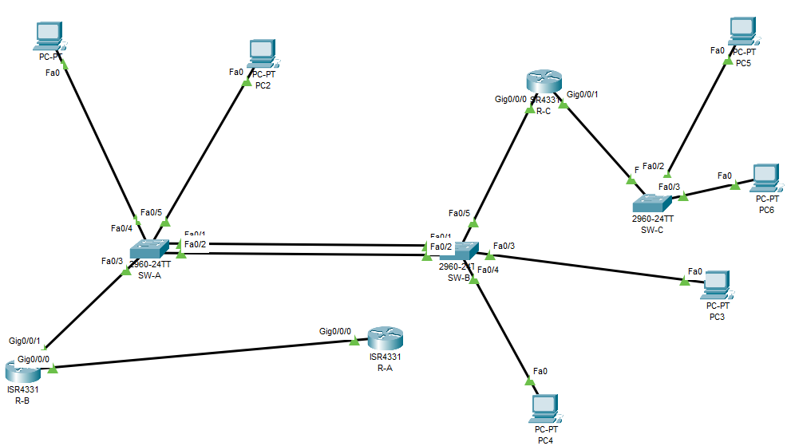

# Проектная работа - Построение сети с нуля

## Топология



## Таблица адресации

| Устройство | Интерфейс | IPv4‑адрес | Маска подсети | Шлюз по умолчанию |
| --- | --- | --- | --- | --- |
| R-B | G0/0/0 | 209.165.221.230 | 255.255.255.248 | - |
|  | G0/0/1.11 | 192.168.11.1 | 255.255.255.0 | - |
|  | G0/0/1.22 | 192.168.22.1 | 255.255.255.0 | - |
|  | G0/0/1.33 | 192.168.33.1 | 255.255.255.0 | - |
|  | G0/0/1.44 | 192.168.44.1 | 255.255.255.0 | - |
|  | G0/0/1.55 | 10.255.0.1 | 255.255.255.252 | - |
|  | G0/0/1.1000 | - | - | - |
| R-C | G0/0/0 | 10.255.0.2 | 255.255.255.252 | - |
|  | G0/0/1.66 | 192.168.66.1 | 255.255.255.0 | - |
|  | G0/0/1.77 | 192.168.77.1 | 255.255.255.0 | - |
|  | G0/0/1.88 | 192.168.88.1 | 255.255.255.0 | - |
|  | G0/0/1.99 | - | - | - |
| R-A | G0/0/0 | 209.165.221.225 | 255.255.255.248 | - |
|  | Loopback 1 | 209.165.221.1 | 255.255.255.224 | - |
| SW-A | VLAN 41 | 192.168.41.2 | 255.255.255.0 | 192.168.41.1 |
| SW-B | VLAN 51 | 192.168.41.3 | 255.255.255.0 | 192.168.41.1 |
| SW-C | VLAN 71 | 192.168.71.2 | 255.255.255.0 | 192.168.71.1 |
| PC1 | NIC | DHCPv4 | 255.255.255.0 | 192.168.22.1 |
| PC2 | NIC | DHCPv4 | 255.255.255.0 | 192.168.33.1 |
| PC3 | NIC | DHCPv4 | 255.255.255.0 | 192.168.22.1 |
| PC4 | NIC | DHCPv4 | 255.255.255.0 | 192.168.44.1 |
| PC5 | NIC | DHCPv4 | 255.255.255.0 | 192.168.77.1 |
| PC6 | NIC | DHCPv4 | 255.255.255.0 | 192.168.88.1 |

## Таблица VLAN

| VLAN | Имя | Назначенный интерфейс |
| --- | --- | --- |
| 11 | Management | R‑B: G0/0/1.11 |
| 22 | Administration | R‑B: G0/0/1.22; SW‑A: порты доступа для PC1, PC3 |
| 33 | Users | R‑B: G0/0/1.33; SW‑A: порт доступа для PC2 |
| 44 | Guest | R‑B: G0/0/1.44; SW‑B: порт доступа для PC4 |
| 55 | OSPF_TRANSIT | R‑B: G0/0/1.55; R‑C: G0/0/0 (транк /30‑линк) |
| 66 | Management | R‑C: G0/0/1.66 |
| 77 | Users | R‑C: G0/0/1.77; SW‑C: порт доступа для PC5 |
| 88 | Guest | R‑C: G0/0/1.88; SW‑C: порт доступа для PC6 |
| 41 | VLAN41 | SW‑A: SVI VLAN 41; порты доступа для PC1, PC2 |
| 51 | VLAN51 | SW‑B: SVI VLAN 51; порты доступа для PC3, PC4 |
| 71 | VLAN71 | SW‑C: SVI VLAN 71; порты доступа для PC5, PC6 |
| 999 | ParkingLot | SW‑A: F0/3–4, F0/9–24, G0/1–2; SW‑B: F0/3–4, F0/8–24, G0/1–2; SW‑C: F0/1–4, F0/8–24, G0/1–2 |
| 1000 | Native | - |

## Часть 1. Настройка сетей VLAN на коммутаторах.
### Шаг 1. Создание сетей VLAN на коммутаторах.

Настройка VLAN коммутатора SW-A.

```
SW-A> enable
SW-A# configure terminal
SW-A(config)# vlan 11
SW-A(config-vlan)# name Management
SW-A(config-vlan)# exit
SW-A(config)# vlan 22
SW-A(config-vlan)# name Administration
SW-A(config-vlan)# exit
SW-A(config)# vlan 33
SW-A(config-vlan)# name Users
SW-A(config-vlan)# exit
SW-A(config)# vlan 41
SW-A(config-vlan)# name VLAN41
SW-A(config-vlan)# exit
SW-A(config)# vlan 999
SW-A(config-vlan)# name ParkingLot
SW-A(config-vlan)# exit
SW-A(config)# vlan 1000
SW-A(config-vlan)# name Native
SW-A(config-vlan)# exit

```

Настройка VLAN коммутатора SW-B.

```
SW-B> enable
SW-B# configure terminal
SW-B(config)# vlan 11
SW-B(config-vlan)# name Management
SW-B(config-vlan)# exit
SW-B(config)# vlan 22
SW-B(config-vlan)# name Administration
SW-B(config-vlan)# exit
SW-B(config)# vlan 33
SW-B(config-vlan)# name Users
SW-B(config-vlan)# exit
SW-B(config)# vlan 44
SW-B(config-vlan)# name Guest
SW-B(config-vlan)# exit
SW-B(config)# vlan 51
SW-B(config-vlan)# name VLAN51
SW-B(config-vlan)# exit
SW-B(config)# vlan 999
SW-B(config-vlan)# name ParkingLot
SW-B(config-vlan)# exit
SW-B(config)# vlan 1000
SW-B(config-vlan)# name Native
SW-B(config-vlan)# exit

```


Настройка VLAN коммутатора SW-C.

```
SW-C> enable
SW-C# configure terminal
SW-C(config)# vlan 11
SW-C(config-vlan)# name Management
SW-C(config-vlan)# exit
SW-C(config)# vlan 66
SW-C(config-vlan)# name Management
SW-C(config-vlan)# exit
SW-C(config)# vlan 71
SW-C(config-vlan)# name VLAN71
SW-C(config-vlan)# exit
SW-C(config)# vlan 77
SW-C(config-vlan)# name Users
SW-C(config-vlan)# exit
SW-C(config)# vlan 88
SW-C(config-vlan)# name Guest
SW-C(config-vlan)# exit
SW-C(config)# vlan 999
SW-C(config-vlan)# name ParkingLot
SW-C(config-vlan)# exit
SW-C(config)# vlan 1000
SW-C(config-vlan)# name Native
SW-C(config-vlan)# exit
SW-C(config)#
```

### Шаг 2. Настройка портов на коммутаторах.

Настройка портов коммутатора SW-A.

```
SW-A(config)# interface vlan 41
SW-A(config-if)# ip address 192.168.41.2 255.255.255.0
SW-A(config-if)# no shutdown
SW-A(config-if)# exit
SW-A(config)# interface fa0/3
SW-A(config-if)# description PC1 Administration (VLAN 22)
SW-A(config-if)# switchport mode access
SW-A(config-if)# switchport access vlan 22
SW-A(config-if)# no shutdown
SW-A(config-if)# exit
SW-A(config)# interface fa0/4
SW-A(config-if)# description PC2 Users (VLAN 33)
SW-A(config-if)# switchport mode access
SW-A(config-if)# switchport access vlan 33
SW-A(config-if)# no shutdown
SW-A(config-if)# exit
SW-A(config)# interface range fa0/5-24, gi0/1-2
SW-A(config-if-range)# description UNUSED (ParkingLot)
SW-A(config-if-range)# switchport mode access
SW-A(config-if-range)# switchport access vlan 999
SW-A(config-if-range)# shutdown
SW-A(config-if-range)# exit
SW-A(config)#
```


Настройка портов коммутатора SW-B.

```
SW-B(config)# interface vlan 51
SW-B(config-if)# ip address 192.168.41.3 255.255.255.0
SW-B(config-if)# no shutdown
SW-B(config-if)# exit
SW-B(config)# interface fa0/3
SW-B(config-if)# description PC3 Administration (VLAN 22)
SW-B(config-if)# switchport mode access
SW-B(config-if)# switchport access vlan 22
SW-B(config-if)# no shutdown
SW-B(config-if)# exit
SW-B(config)# interface fa0/4
SW-B(config-if)# description PC4 Guest (VLAN 44)
SW-B(config-if)# switchport mode access
SW-B(config-if)# switchport access vlan 44
SW-B(config-if)# no shutdown
SW-B(config-if)# exit
SW-B(config)# interface fa0/5
SW-B(config-if)# description PC6 Guest (VLAN 88)
SW-B(config-if)# switchport mode access
SW-B(config-if)# switchport access vlan 88
SW-B(config-if)# no shutdown
SW-B(config-if)# exit
SW-B(config)# interface range fa0/6-24, gi0/1-2
SW-B(config-if-range)# description UNUSED (ParkingLot)
SW-B(config-if-range)# switchport mode access
SW-B(config-if-range)# switchport access vlan 999
SW-B(config-if-range)# shutdown
SW-B(config-if-range)# exit
SW-B(config)#
```

Настройка портов коммутатора SW-C.

```
SW-C(config)# interface vlan 71
SW-C(config-if)# ip address 192.168.71.2 255.255.255.0
SW-C(config-if)# no shutdown
SW-C(config-if)# exit
SW-C(config)# interface fa0/2
SW-C(config-if)# description PC5 Users (VLAN 77)
SW-C(config-if)# switchport mode access
SW-C(config-if)# switchport access vlan 77
SW-C(config-if)# no shutdown
SW-C(config-if)# exit
SW-C(config)# interface range fa0/1, fa0/3-24, gi0/1-2
SW-C(config-if-range)# description UNUSED (ParkingLot)
SW-C(config-if-range)# switchport mode access
SW-C(config-if-range)# switchport access vlan 999
SW-C(config-if-range)# shutdown
SW-C(config-if-range)# exit
SW-C(config)#
```

### Шаг 3. Проверка.

```
SW-A# show vlan brief 
VLAN Name                             Status    Ports
---- -------------------------------- --------- -------------------------------
1    default                          active    Fa0/1, Fa0/2, Fa0/5
11   Management                       active    
22   Administration                   active    Fa0/6
33   Users                            active    Fa0/7, Fa0/8
41   VLAN41                           active    
999  ParkingLot                       active    Fa0/3, Fa0/4, Fa0/9, Fa0/10
                                                Fa0/11, Fa0/12, Fa0/13, Fa0/14
                                                Fa0/15, Fa0/16, Fa0/17, Fa0/18
                                                Fa0/19, Fa0/20, Fa0/21, Fa0/22
                                                Fa0/23, Fa0/24, Gig0/1, Gig0/2
1000 Native                           active    
1002 fddi-default                     active    
1003 token-ring-default               active    
1004 fddinet-default                  active    
1005 trnet-default                    active 

SW-A# show interfaces status 

Port      Name               Status       Vlan       Duplex  Speed Type
Fa0/1                        connected    1          auto    auto  10/100BaseTX
Fa0/2                        connected    1          auto    auto  10/100BaseTX
Fa0/3     UNUSED             disabled     999        auto    auto  10/100BaseTX
Fa0/4     UNUSED             disabled     999        auto    auto  10/100BaseTX
Fa0/5                        notconnect   1          auto    auto  10/100BaseTX
Fa0/6     PC1 Administration connected    22         auto    auto  10/100BaseTX
Fa0/7     PC2 Users          connected    33         auto    auto  10/100BaseTX
Fa0/8     PC2 Users          connected    33         auto    auto  10/100BaseTX
Fa0/9     UNUSED             disabled     999        auto    auto  10/100BaseTX
Fa0/10    UNUSED             disabled     999        auto    auto  10/100BaseTX
Fa0/11    UNUSED             disabled     999        auto    auto  10/100BaseTX
Fa0/12    UNUSED             disabled     999        auto    auto  10/100BaseTX
Fa0/13    UNUSED             disabled     999        auto    auto  10/100BaseTX
Fa0/14    UNUSED             disabled     999        auto    auto  10/100BaseTX
Fa0/15    UNUSED             disabled     999        auto    auto  10/100BaseTX
Fa0/16    UNUSED             disabled     999        auto    auto  10/100BaseTX
Fa0/17    UNUSED             disabled     999        auto    auto  10/100BaseTX
Fa0/18    UNUSED             disabled     999        auto    auto  10/100BaseTX
Fa0/19    UNUSED             disabled     999        auto    auto  10/100BaseTX
Fa0/20    UNUSED             disabled     999        auto    auto  10/100BaseTX
Fa0/21    UNUSED             disabled     999        auto    auto  10/100BaseTX
Fa0/22    UNUSED             disabled     999        auto    auto  10/100BaseTX
Fa0/23    UNUSED             disabled     999        auto    auto  10/100BaseTX
Fa0/24    UNUSED             disabled     999        auto    auto  10/100BaseTX
Gig0/1    UNUSED             disabled     999        auto    auto  10/100BaseTX
Gig0/2    UNUSED             disabled     999        auto    auto  10/100BaseTX

SW-B# show vlan brief 
VLAN Name                             Status    Ports
---- -------------------------------- --------- -------------------------------
1    default                          active    Fa0/1, Fa0/2, Fa0/3
11   Management                       active    
22   Administration                   active    Fa0/6
33   Users                            active    
44   Guest                            active    Fa0/7
51   VLAN51                           active    
88   Guest                              active    Fa0/8
999  ParkingLot                       active    Fa0/4, Fa0/5, Fa0/9, Fa0/10
                                                Fa0/11, Fa0/12, Fa0/13, Fa0/14
                                                Fa0/15, Fa0/16, Fa0/17, Fa0/18
                                                Fa0/19, Fa0/20, Fa0/21, Fa0/22
                                                Fa0/23, Fa0/24, Gig0/1, Gig0/2
1000 Native                           active    
1002 fddi-default                     active    
1003 token-ring-default               active    
1004 fddinet-default                  active    
1005 trnet-default                    active 

SW-B# show interfaces status 

Port      Name               Status       Vlan       Duplex  Speed Type
Fa0/1                        connected    1          auto    auto  10/100BaseTX
Fa0/2                        connected    1          auto    auto  10/100BaseTX
Fa0/3                        connected    1          auto    auto  10/100BaseTX
Fa0/4     UNUSED             disabled     999        auto    auto  10/100BaseTX
Fa0/5     UNUSED             disabled     999        auto    auto  10/100BaseTX
Fa0/6     PC3 Administration connected    22         auto    auto  10/100BaseTX
Fa0/7     PC4 Guest          connected    44         auto    auto  10/100BaseTX
Fa0/8     PC6 Guest          connected    88         auto    auto  10/100BaseTX
Fa0/9     UNUSED             disabled     999        auto    auto  10/100BaseTX
Fa0/10    UNUSED             disabled     999        auto    auto  10/100BaseTX
Fa0/11    UNUSED             disabled     999        auto    auto  10/100BaseTX
Fa0/12    UNUSED             disabled     999        auto    auto  10/100BaseTX
Fa0/13    UNUSED             disabled     999        auto    auto  10/100BaseTX
Fa0/14    UNUSED             disabled     999        auto    auto  10/100BaseTX
Fa0/15    UNUSED             disabled     999        auto    auto  10/100BaseTX
Fa0/16    UNUSED             disabled     999        auto    auto  10/100BaseTX
Fa0/17    UNUSED             disabled     999        auto    auto  10/100BaseTX
Fa0/18    UNUSED             disabled     999        auto    auto  10/100BaseTX
Fa0/19    UNUSED             disabled     999        auto    auto  10/100BaseTX
Fa0/20    UNUSED             disabled     999        auto    auto  10/100BaseTX
Fa0/21    UNUSED             disabled     999        auto    auto  10/100BaseTX
Fa0/22    UNUSED             disabled     999        auto    auto  10/100BaseTX
Fa0/23    UNUSED             disabled     999        auto    auto  10/100BaseTX
Fa0/24    UNUSED             disabled     999        auto    auto  10/100BaseTX
Gig0/1    UNUSED             disabled     999        auto    auto  10/100BaseTX
Gig0/2    UNUSED             disabled     999        auto    auto  10/100BaseTX

SW-C# show vlan brief 
VLAN Name                             Status    Ports
---- -------------------------------- --------- -------------------------------
1    default                          active    Fa0/3
11   Management                       active    
66   Management                       active    
71   VLAN71                           active    
77   Users                            active    Fa0/2
88   Guest                            active    
999  ParkingLot                       active    Fa0/1, Fa0/4, Fa0/5, Fa0/6
                                                Fa0/7, Fa0/8, Fa0/9, Fa0/10
                                                Fa0/11, Fa0/12, Fa0/13, Fa0/14
                                                Fa0/15, Fa0/16, Fa0/17, Fa0/18
                                                Fa0/19, Fa0/20, Fa0/21, Fa0/22
                                                Fa0/23, Fa0/24, Gig0/1, Gig0/2
1000 Native                           active    
1002 fddi-default                     active    
1003 token-ring-default               active    
1004 fddinet-default                  active    
1005 trnet-default                    active    

SW-C# show interfaces status 

Port      Name               Status       Vlan       Duplex  Speed Type
Fa0/1     UNUSED             notconnect   999        auto    auto  10/100BaseTX
Fa0/2     PC5 Users          connected    77         auto    auto  10/100BaseTX
Fa0/3                        notconnect   1          auto    auto  10/100BaseTX
Fa0/4     UNUSED             notconnect   999        auto    auto  10/100BaseTX
Fa0/5     UNUSED             notconnect   999        auto    auto  10/100BaseTX
Fa0/6     UNUSED             notconnect   999        auto    auto  10/100BaseTX
Fa0/7     UNUSED             notconnect   999        auto    auto  10/100BaseTX
Fa0/8     UNUSED             notconnect   999        auto    auto  10/100BaseTX
Fa0/9     UNUSED             notconnect   999        auto    auto  10/100BaseTX
Fa0/10    UNUSED             notconnect   999        auto    auto  10/100BaseTX
Fa0/11    UNUSED             notconnect   999        auto    auto  10/100BaseTX
Fa0/12    UNUSED             notconnect   999        auto    auto  10/100BaseTX
Fa0/13    UNUSED             notconnect   999        auto    auto  10/100BaseTX
Fa0/14    UNUSED             notconnect   999        auto    auto  10/100BaseTX
Fa0/15    UNUSED             notconnect   999        auto    auto  10/100BaseTX
Fa0/16    UNUSED             notconnect   999        auto    auto  10/100BaseTX
Fa0/17    UNUSED             notconnect   999        auto    auto  10/100BaseTX
Fa0/18    UNUSED             notconnect   999        auto    auto  10/100BaseTX
Fa0/19    UNUSED             notconnect   999        auto    auto  10/100BaseTX
Fa0/20    UNUSED             notconnect   999        auto    auto  10/100BaseTX
Fa0/21    UNUSED             notconnect   999        auto    auto  10/100BaseTX
Fa0/22    UNUSED             notconnect   999        auto    auto  10/100BaseTX
Fa0/23    UNUSED             notconnect   999        auto    auto  10/100BaseTX
Fa0/24    UNUSED             notconnect   999        auto    auto  10/100BaseTX
Gig0/1    UNUSED             disabled     999        auto    auto  10/100BaseTX
Gig0/2    UNUSED             disabled     999        auto    auto  10/100BaseTX
```

## Часть 2. Настройка Trunk и резервирования
### Шаг 1. Настройка Trunk соединений.

```
SW-A(config)# interface range fa0/1-2
SW-A(config-if-range)# description TRUNK_TO_SW-B
SW-A(config-if-range)# switchport mode trunk
SW-A(config-if-range)# switchport trunk native vlan 1000
SW-A(config-if-range)# switchport trunk allowed vlan 11,22,33,41,44,51,66,71,77,88,999,1000
SW-A(config-if-range)# switchport nonegotiate
SW-A(config-if-range)# no shutdown
SW-A(config-if-range)# exit
SW-A(config)#


SW-B(config)# interface range fa0/1-2
SW-B(config-if-range)# description TRUNK_TO_SW-A
SW-B(config-if-range)# switchport mode trunk
SW-B(config-if-range)# switchport trunk native vlan 1000
SW-B(config-if-range)# switchport trunk allowed vlan 11,22,33,41,44,51,66,71,77,88,999,1000
SW-B(config-if-range)# switchport nonegotiate
SW-B(config-if-range)# no shutdown
SW-B(config-if-range)# exit
SW-B(config)# interface fa0/3
SW-B(config-if)# description TRUNK_TO_SW-C
SW-B(config-if)# switchport mode trunk
SW-B(config-if)# switchport trunk native vlan 1000
SW-B(config-if)# switchport trunk allowed vlan 11,22,33,41,44,51,66,71,77,88,999,1000
SW-B(config-if)# switchport nonegotiate
SW-B(config-if)# no shutdown
SW-B(config-if)# exit
SW-B(config)#


SW-C(config)# interface fa0/1
SW-C(config-if)# description TRUNK_TO_SW-B
SW-C(config-if)# switchport mode trunk
SW-C(config-if)# switchport trunk native vlan 1000
SW-C(config-if)# switchport trunk allowed vlan 11,22,33,41,44,51,66,71,77,88,999,1000
SW-C(config-if)# switchport nonegotiate
SW-C(config-if)# no shutdown
SW-C(config-if)# exit
SW-C(config)#

```

### Шаг 2. Настройка режима STP.

```
SW-A(config)# spanning-tree mode pvst
SW-A(config)# spanning-tree vlan 11,22,33,41,44,51,66,71,77,88,999,1000 root primary
SW-A(config)#
SW-B(config)# spanning-tree mode pvst
SW-B(config)# spanning-tree vlan 11,22,33,41,44,51,66,71,77,88,999,1000 root secondary
SW-B(config)#
SW-C(config)# spanning-tree mode pvst
SW-C(config)#
```

### Шаг 3. Проверка Root Bridge и резервирования

```
SW-A# show spanning-tree vlan 22
VLAN0022
  Spanning tree enabled protocol ieee
  Root ID    Priority    24594
         Address     00D0.BC50.9A25
         This bridge is the root
         Hello Time  2 sec  Max Age 20 sec  Forward Delay 15 sec

  Bridge ID  Priority    24594  (priority 24576 sys-id-ext 22)
         Address     00D0.BC50.9A25
         Hello Time  2 sec  Max Age 20 sec  Forward Delay 15 sec
         Aging Time  20

Interface        Role Sts Cost      Prio.Nbr Type
---------------- ---- --- --------- -------- --------------------------------
Fa0/3            Desg FWD 19        128.3    P2p
Fa0/1            Desg FWD 19        128.1    P2p
Fa0/2            Desg FWD 19        128.2    P2p

SW-B# show spanning-tree vlan 22
VLAN0022
  Spanning tree enabled protocol ieee
  Root ID    Priority    24594
         Address     00D0.BC50.9A25
         Cost        19
         Port        1(FastEthernet0/1)
         Hello Time  2 sec  Max Age 20 sec  Forward Delay 15 sec

  Bridge ID  Priority    28690  (priority 28672 sys-id-ext 22)
         Address     00E0.8FBD.0AA1
         Hello Time  2 sec  Max Age 20 sec  Forward Delay 15 sec
         Aging Time  20

Interface        Role Sts Cost      Prio.Nbr Type
---------------- ---- --- --------- -------- --------------------------------
Fa0/3            Desg FWD 19        128.3    P2p
Fa0/1            Root FWD 19        128.1    P2p
Fa0/3            Altn BLK 19        128.3    P2p

SW-C# show spanning-tree vlan 77
VLAN0077
  Spanning tree enabled protocol ieee
  Root ID    Priority    24599
         Address     00D0.BC50.9A25
         Cost        38
         Port        3(FastEthernet0/3)
         Hello Time  2 sec  Max Age 20 sec  Forward Delay 15 sec

  Bridge ID  Priority    28695  (priority 28672 sys-id-ext 77)
         Address     00E0.8FBD.0AA2
         Hello Time  2 sec  Max Age 20 sec  Forward Delay 15 sec
         Aging Time  20

Interface        Role Sts Cost      Prio.Nbr Type
---------------- ---- --- --------- -------- --------------------------------
Fa0/2            Desg FWD 19        128.2    P2p
Fa0/1            Root FWD 19        128.1    P2p
```

### Шаг 4. Настройка PortFast и BPDU Guard на портах доступа

```
SW-A(config)# interface range fa0/3-4
SW-A(config-if-range)# spanning-tree portfast
SW-A(config-if-range)# spanning-tree bpduguard enable
SW-A(config-if-range)# exit
SW-A(config)#


SW-B(config)# interface range fa0/3-5
SW-B(config-if-range)# spanning-tree portfast
SW-B(config-if-range)# spanning-tree bpduguard enable
SW-B(config-if-range)# exit
SW-B(config)#


SW-C(config)# interface fa0/2
SW-C(config-if)# spanning-tree portfast
SW-C(config-if)# spanning-tree bpduguard enable
SW-C(config-if)# exit
SW-C(config)#
```


### Шаг 5. Проверка итоговых конфигураций

```
SW-A# show interfaces trunk 
Port        Mode         Encapsulation  Status        Native vlan
Fa0/1       on           802.1q         trunking      1000
Fa0/2       on           802.1q         trunking      1000

Port        Vlans allowed on trunk
Fa0/1       11,22,33,41,44,51,66,71,77,88,999,1000
Fa0/2       11,22,33,41,44,51,66,71,77,88,999,1000

Port        Vlans allowed and active in management domain
Fa0/1       11,22,33,41,44,51,66,71,77,88,999,1000
Fa0/2       11,22,33,41,44,51,66,71,77,88,999,1000

Port        Vlans in spanning tree forwarding state and not pruned
Fa0/1       11,22,33,41,44,51,66,71,77,88,999,1000
Fa0/2       11,22,33,41,44,51,66,71,77,88,999,1000

SW-A# show spanning-tree vlan 22
VLAN0022
  Spanning tree enabled protocol ieee
  Root ID    Priority    24594
         Address     00D0.BC50.9A25
         This bridge is the root
         Hello Time  2 sec  Max Age 20 sec  Forward Delay 15 sec

  Bridge ID  Priority    24594  (priority 24576 sys-id-ext 22)
         Address     00D0.BC50.9A25
         Hello Time  2 sec  Max Age 20 sec  Forward Delay 15 sec
         Aging Time  20

Interface        Role Sts Cost      Prio.Nbr Type
---------------- ---- --- --------- -------- --------------------------------
Fa0/3            Desg FWD 19        128.3    P2p
Fa0/1            Desg FWD 19        128.1    P2p
Fa0/2            Desg FWD 19        128.2    P2p

SW-B# show interfaces trunk 
Port        Mode         Encapsulation  Status        Native vlan
Fa0/1       on           802.1q         trunking      1000
Fa0/2       on           802.1q         trunking      1000
Fa0/3       on           802.1q         trunking      1000

Port        Vlans allowed on trunk
Fa0/1       11,22,33,41,44,51,66,71,77,88,999,1000
Fa0/2       11,22,33,41,44,51,66,71,77,88,999,1000
Fa0/3       11,22,33,41,44,51,66,71,77,88,999,1000

Port        Vlans allowed and active in management domain
Fa0/1       11,22,33,41,44,51,66,71,77,88,999,1000
Fa0/2       11,22,33,41,44,51,66,71,77,88,999,1000
Fa0/3       11,22,33,41,44,51,66,71,77,88,999,1000

Port        Vlans in spanning tree forwarding state and not pruned
Fa0/1       11,22,33,41,44,51,66,71,77,88,999,1000
Fa0/2       11,22,33,41,44,51,66,71,77,88,999,1000
Fa0/3       11,22,33,41,44,51,66,71,77,88,999,1000

SW-B# show spanning-tree vlan 22
VLAN0022
  Spanning tree enabled protocol ieee
  Root ID    Priority    24594
         Address     00D0.BC50.9A25
         Cost        19
         Port        1(FastEthernet0/1)
         Hello Time  2 sec  Max Age 20 sec  Forward Delay 15 sec

  Bridge ID  Priority    28690  (priority 28672 sys-id-ext 22)
         Address     00E0.8FBD.0AA1
         Hello Time  2 sec  Max Age 20 sec  Forward Delay 15 sec
         Aging Time  20

Interface        Role Sts Cost      Prio.Nbr Type
---------------- ---- --- --------- -------- --------------------------------
Fa0/3            Desg FWD 19        128.3    P2p
Fa0/1            Root FWD 19        128.1    P2p
Fa0/2            Altn BLK 19        128.2    P2p

SW-C# show interfaces trunk
Port      Mode     Encapsulation  Status      Native vlan
Fa0/1     on       802.1q         trunking    1000

Port      Vlans allowed on trunk
Fa0/1     11,22,33,41,44,51,66,71,77,88,999,1000

Port      Vlans allowed and active in management domain
Fa0/1     11,22,33,41,44,51,66,71,77,88,999,1000

Port      Vlans in spanning tree forwarding state and not pruned
Fa0/1     11,22,33,41,44,51,66,71,77,88,999,1000

SW-C# show spanning-tree vlan 77
VLAN0077
  Spanning tree enabled protocol ieee
  Root ID    Priority    24599
         Address     00D0.BC50.9A25
         Cost        38
         Port        1(FastEthernet0/1)
         Hello Time  2 sec  Max Age 20 sec  Forward Delay 15 sec

  Bridge ID  Priority    28695  (priority 28672 sys-id-ext 77)
         Address     00E0.8FBD.0AA2
         Hello Time  2 sec  Max Age 20 sec  Forward Delay 15 sec
         Aging Time  20

Interface        Role Sts Cost      Prio.Nbr Type
---------------- ---- --- --------- -------- --------------------------------
Fa0/2            Desg FWD 19        128.2    P2p
Fa0/1            Root FWD 19        128.1    P2p
```

## Часть 3. Настройка IPv4 и Router-on-a-Stick
### Шаг 1. Настройка интерфейсов на R-B.

```
R-B> enable
R-B# configure terminal
R-B(config)# interface g0/0/0
R-B(config-if)# ip address 209.165.221.230 255.255.255.248
R-B(config-if)# no shutdown
R-B(config-if)# exit
R-B(config)# interface g0/0/1.11
R-B(config-subif)# encapsulation dot1Q 11
R-B(config-subif)# ip address 192.168.11.1 255.255.255.0
R-B(config-subif)# no shutdown
R-B(config-subif)# exit
R-B(config)# interface g0/0/1.22
R-B(config-subif)# encapsulation dot1Q 22
R-B(config-subif)# ip address 192.168.22.1 255.255.255.0
R-B(config-subif)# no shutdown
R-B(config-subif)# exit
R-B(config)# interface g0/0/1.33
R-B(config-subif)# encapsulation dot1Q 33
R-B(config-subif)# ip address 192.168.33.1 255.255.255.0
R-B(config-subif)# no shutdown
R-B(config-subif)# exit
R-B(config)# interface g0/0/1.44
R-B(config-subif)# encapsulation dot1Q 44
R-B(config-subif)# ip address 192.168.44.1 255.255.255.0
R-B(config-subif)# no shutdown
R-B(config-subif)# exit
R-B(config)# interface g0/0/1.55
R-B(config-subif)# encapsulation dot1Q 55
R-B(config-subif)# ip address 10.255.0.1 255.255.255.252
R-B(config-subif)# no shutdown
R-B(config-subif)# exit
R-B(config)# interface g0/0/1
R-B(config-if)# no shutdown
R-B(config-if)# exit
R-B(config)#
R-B#
```

### Шаг 2. Настройка интерфейсов на R-C.

```
R-C> enable
R-C# configure terminal
R-C(config)# interface g0/0/0
R-C(config-if)# encapsulation dot1Q 55
R-C(config-if)# ip address 10.255.0.2 255.255.255.252
R-C(config-if)# no shutdown
R-C(config-if)# exit
R-C(config)# interface g0/0/1.66
R-C(config-subif)# encapsulation dot1Q 66
R-C(config-subif)# ip address 192.168.66.1 255.255.255.0
R-C(config-subif)# no shutdown
R-C(config-subif)# exit
R-C(config)# interface g0/0/1.77
R-C(config-subif)# encapsulation dot1Q 77
R-C(config-subif)# ip address 192.168.77.1 255.255.255.0
R-C(config-subif)# no shutdown
R-C(config-subif)# exit
R-C(config)# interface g0/0/1.88
R-C(config-subif)# encapsulation dot1Q 88
R-C(config-subif)# ip address 192.168.88.1 255.255.255.0
R-C(config-subif)# no shutdown
R-C(config-subif)# exit
R-C(config)# interface g0/0/1
R-C(config-if)# no shutdown
R-C(config-if)# exit
R-C(config)#
R-C#
```

### Шаг 3. Настройка интерфейсов на R-A.

```
R-A> enable
R-A# configure terminal
R-A(config)# interface g0/0/0
R-A(config-if)# ip address 209.165.221.225 255.255.255.248
R-A(config-if)# no shutdown
R-A(config-if)# exit
R-A(config)# interface loopback 1
R-A(config-if)# ip address 209.165.221.1 255.255.255.224
R-A(config-if)# no shutdown
R-A(config-if)# exit
R-A(config)#
R-A#
```

### Шаг 4. Настройка Management VLAN на коммутаторах

```
SW-A>en
SW-A#conf t
Enter configuration commands, one per line.  End with CNTL/Z.
SW-A(config)#interface vlan 11
SW-A(config-if)#description MANAGEMENT
SW-A(config-if)#ip address 192.168.11.2 255.255.255.0
SW-A(config-if)#no shutdown 
SW-A(config-if)#ex
SW-A(config)#ip default-gateway 192.168.11.1
SW-A(config)#

SW-B>en
SW-B#conf t
Enter configuration commands, one per line.  End with CNTL/Z.
SW-B(config)#interface vlan 11
SW-B(config-if)#description MANAGEMENT
SW-B(config-if)#ip address 192.168.11.3 255.255.255.0
SW-B(config-if)#no shutdown 
SW-B(config-if)#ex
SW-B(config)#ip default-gateway 192.168.11.1
SW-B(config)#ex

SW-C>en
SW-C#conf t
Enter configuration commands, one per line.  End with CNTL/Z.
SW-C(config)#interface vlan 11
SW-C(config-if)#description MANAGEMENT
SW-C(config-if)#ip address 192.168.110.2 255.255.255.0
SW-C(config-if)#no shutdown 
SW-C(config-if)#ex
SW-C(config)#ex

```

### Шаг 5. Проверки сетевой связанности маршрутизаторов и коммутаторов

```
SW-A#ping 192.168.41.1
Type escape sequence to abort.
Sending 5, 100-byte ICMP Echos to 192.168.41.1, timeout is 2 seconds:
.!!!!
Success rate is 80 percent (4/5), round-trip min/avg/max = 0/0/0 ms

SW-A#ping 192.168.41.3
Type escape sequence to abort.
Sending 5, 100-byte ICMP Echos to 192.168.41.3, timeout is 2 seconds:
.!!!!
Success rate is 80 percent (4/5), round-trip min/avg/max = 0/0/0 ms


SW-B#ping 192.168.41.1
Type escape sequence to abort.
Sending 5, 100-byte ICMP Echos to 192.168.41.1, timeout is 2 seconds:
.!!!!
Success rate is 80 percent (4/5), round-trip min/avg/max = 0/0/0 ms

SW-B#ping 192.168.41.2
Type escape sequence to abort.
Sending 5, 100-byte ICMP Echos to 192.168.41.2, timeout is 2 seconds:
.!!!!
Success rate is 80 percent (4/5), round-trip min/avg/max = 0/0/0 ms


SW-C#ping 192.168.71.1
Type escape sequence to abort.
Sending 5, 100-byte ICMP Echos to 192.168.71.1, timeout is 2 seconds:
.!!!!
Success rate is 80 percent (4/5), round-trip min/avg/max = 0/0/0 ms


R-B#ping 192.168.11.1
Type escape sequence to abort.
Sending 5, 100-byte ICMP Echos to 192.168.11.1, timeout is 2 seconds:
.!!!!
Success rate is 80 percent (4/5), round-trip min/avg/max = 0/0/0 ms

R-B#ping 10.255.0.2
Type escape sequence to abort.
Sending 5, 100-byte ICMP Echos to 10.255.0.2, timeout is 2 seconds:
.!!!!
Success rate is 80 percent (4/5), round-trip min/avg/max = 0/0/0 ms


R-C#ping 10.255.0.1
Type escape sequence to abort.
Sending 5, 100-byte ICMP Echos to 10.255.0.1, timeout is 2 seconds:
.!!!!
Success rate is 80 percent (4/5), round-trip min/avg/max = 0/0/0 ms


R-A#ping 209.165.221.230
Type escape sequence to abort.
Sending 5, 100-byte ICMP Echos to 209.165.221.230, timeout is 2 seconds:
.!!!!
Success rate is 80 percent (4/5), round-trip min/avg/max = 0/0/0 ms
```

## Часть 4. Настройка DHCPv4

### Шаг 1. Исключение служебных адресов и создание пулов на R-B

```
R-B>enable
R-B#configure terminal
Enter configuration commands, one per line.  End with CNTL/Z.
R-B(config)#ip dhcp excluded-address 192.168.22.1 192.168.22.10
R-B(config)#ip dhcp excluded-address 192.168.33.1 192.168.33.10
R-B(config)#ip dhcp excluded-address 192.168.44.1 192.168.44.10
R-B(config)#ip dhcp pool HQ_ADMINISTRATION
R-B(dhcp-config)#network 192.168.22.0 255.255.255.0
R-B(dhcp-config)#default-router 192.168.22.1
R-B(dhcp-config)#exit
R-B(config)#ip dhcp pool HQ_USERS
R-B(dhcp-config)#network 192.168.33.0 255.255.255.0
R-B(dhcp-config)#default-router 192.168.33.1
R-B(dhcp-config)#exit
R-B(config)#ip dhcp pool HQ_GUEST
R-B(dhcp-config)#network 192.168.44.0 255.255.255.0
R-B(dhcp-config)#default-router 192.168.44.1
R-B(dhcp-config)#exit
R-B(config)#exit
```


### Шаг 2. Исключение служебных адресов и создание пулов на R-C

```
R-C#configure terminal
Enter configuration commands, one per line.  End with CNTL/Z.
R-C(config)#ip dhcp excluded-address 192.168.77.1 192.168.77.10
R-C(config)#ip dhcp excluded-address 192.168.88.1 192.168.88.10
R-C(config)#ip dhcp pool BRANCH_USERS
R-C(dhcp-config)#network 192.168.77.0 255.255.255.0
R-C(dhcp-config)#default-router 192.168.77.1
R-C(dhcp-config)#exit
R-C(config)#ip dhcp pool BRANCH_GUEST
R-C(dhcp-config)#network 192.168.88.0 255.255.255.0
R-C(dhcp-config)#default-router 192.168.88.1
R-C(dhcp-config)#exit
R-C(config)#exit
```


### Шаг 3. Ping шлюзов с ПК

PC1 

```
C:\>ping 192.168.22.1

Pinging 192.168.22.1 with 32 bytes of data:

Reply from 192.168.22.1: bytes=32 time<1ms TTL=255
Reply from 192.168.22.1: bytes=32 time<1ms TTL=255
Reply from 192.168.22.1: bytes=32 time<1ms TTL=255
Reply from 192.168.22.1: bytes=32 time<1ms TTL=255

Ping statistics for 192.168.22.1:
    Packets: Sent = 4, Received = 4, Lost = 0 (0% loss),
    Approximate round trip times in milli-seconds:
    Minimum = 0ms, Maximum = 0ms, Average = 0ms

C:\>
```

PC2

```
C:\>ping 192.168.33.1

Pinging 192.168.33.1 with 32 bytes of data:

Reply from 192.168.33.1: bytes=32 time<1ms TTL=255
Reply from 192.168.33.1: bytes=32 time<1ms TTL=255
Reply from 192.168.33.1: bytes=32 time<1ms TTL=255
Reply from 192.168.33.1: bytes=32 time<1ms TTL=255

Ping statistics for 192.168.33.1:
    Packets: Sent = 4, Received = 4, Lost = 0 (0% loss),
    Approximate round trip times in milli-seconds:
    Minimum = 0ms, Maximum = 0ms, Average = 0ms

C:\>
```

PC3

```
C:\>ping 192.168.22.1

Pinging 192.168.22.1 with 32 bytes of data:

Reply from 192.168.22.1: bytes=32 time<1ms TTL=255
Reply from 192.168.22.1: bytes=32 time<1ms TTL=255
Reply from 192.168.22.1: bytes=32 time<1ms TTL=255
Reply from 192.168.22.1: bytes=32 time<1ms TTL=255

Ping statistics for 192.168.22.1:
    Packets: Sent = 4, Received = 4, Lost = 0 (0% loss),
    Approximate round trip times in milli-seconds:
    Minimum = 0ms, Maximum = 0ms, Average = 0ms

C:\>
```

PC4

```
C:\>ping 192.168.44.1

Pinging 192.168.44.1 with 32 bytes of data:

Reply from 192.168.44.1: bytes=32 time<1ms TTL=255
Reply from 192.168.44.1: bytes=32 time<1ms TTL=255
Reply from 192.168.44.1: bytes=32 time<1ms TTL=255
Reply from 192.168.44.1: bytes=32 time<1ms TTL=255

Ping statistics for 192.168.44.1:
    Packets: Sent = 4, Received = 4, Lost = 0 (0% loss),
    Approximate round trip times in milli-seconds:
    Minimum = 0ms, Maximum = 0ms, Average = 0ms

C:\>
```

PC5

```
C:\>ping 192.168.77.1

Pinging 192.168.77.1 with 32 bytes of data:

Reply from 192.168.77.1: bytes=32 time<1ms TTL=255
Reply from 192.168.77.1: bytes=32 time<1ms TTL=255
Reply from 192.168.77.1: bytes=32 time<1ms TTL=255
Reply from 192.168.77.1: bytes=32 time<1ms TTL=255

Ping statistics for 192.168.77.1:
    Packets: Sent = 4, Received = 4, Lost = 0 (0% loss),
    Approximate round trip times in milli-seconds:
    Minimum = 0ms, Maximum = 0ms, Average = 0ms

C:\>
```

PC6

```
C:\>ping 192.168.88.1

Pinging 192.168.88.1 with 32 bytes of data:

Reply from 192.168.88.1: bytes=32 time<1ms TTL=255
Reply from 192.168.88.1: bytes=32 time<1ms TTL=255
Reply from 192.168.88.1: bytes=32 time<1ms TTL=255
Reply from 192.168.88.1: bytes=32 time<1ms TTL=255

Ping statistics for 192.168.88.1:
    Packets: Sent = 4, Received = 4, Lost = 0 (0% loss),
    Approximate round trip times in milli-seconds:
    Minimum = 0ms, Maximum = 0ms, Average = 0ms

C:\>
```

## Часть 5. Статическая и динамическая маршрутизация

### Шаг 1. Статический маршрут по умолчанию на R1

```
R-B>enable
R-B#configure terminal
Enter configuration commands, one per line. End with CNTL/Z.
R-B(config)#ip route 0.0.0.0 0.0.0.0 209.165.221.230
R-B(config)#end
R-B#
%SYS-5-CONFIG_I: Configured from console by console
R-B#show ip route
Codes: L - local, C - connected, S - static, R - RIP, M - mobile, B - BGP
       D - EIGRP, EX - EIGRP external, O - OSPF, IA - OSPF inter area
       N1 - OSPF NSSA external type 1, N2 - OSPF NSSA external type 2
       E1 - OSPF external type 1, E2 - OSPF external type 2, E - EGP
       i - IS-IS, L1 - IS-IS level-1, L2 - IS-IS level-2, ia - IS-IS inter area
       * - candidate default, U - per-user static route, o - ODR
       P - periodic downloaded static route

Gateway of last resort is 209.165.221.230 to network 0.0.0.0

     10.0.0.0/8 is variably subnetted, 2 subnets, 2 masks
C       10.255.0.0/30 is directly connected, GigabitEthernet0/0/1.55
L       10.255.0.1/32 is directly connected, GigabitEthernet0/0/1.55
     192.168.11.0/24 is variably subnetted, 2 subnets, 2 masks
C       192.168.11.0/24 is directly connected, GigabitEthernet0/0/1.11
L       192.168.11.1/32 is directly connected, GigabitEthernet0/0/1.11
     192.168.22.0/24 is variably subnetted, 2 subnets, 2 masks
C       192.168.22.0/24 is directly connected, GigabitEthernet0/0/1.22
L       192.168.22.1/32 is directly connected, GigabitEthernet0/0/1.22
     192.168.33.0/24 is variably subnetted, 2 subnets, 2 masks
C       192.168.33.0/24 is directly connected, GigabitEthernet0/0/1.33
L       192.168.33.1/32 is directly connected, GigabitEthernet0/0/1.33
     192.168.44.0/24 is variably subnetted, 2 subnets, 2 masks
C       192.168.44.0/24 is directly connected, GigabitEthernet0/0/1.44
L       192.168.44.1/32 is directly connected, GigabitEthernet0/0/1.44
     209.165.221.0/24 is variably subnetted, 2 subnets, 2 masks
C       209.165.221.224/29 is directly connected, GigabitEthernet0/0/0
L       209.165.221.230/32 is directly connected, GigabitEthernet0/0/0
S*   0.0.0.0/0 [1/0] via 209.165.221.230
R-B#
R-B#ping 209.165.221.225
Type escape sequence to abort.
Sending 5, 100-byte ICMP Echos to 209.165.221.225, timeout is 2 seconds:
!!!!!
Success rate is 100 percent (5/5), round-trip min/avg/max = 0/0/0 ms
R-B#
```
   
### Шаг 2. Настройка OSPF на R1

```
R-B#configure terminal
Enter configuration commands, one per line. End with CNTL/Z.
R-B(config)#router ospf 56
R-B(config-router)#router-id 1.1.1.1
R-B(config-router)#network 192.168.11.0 0.0.0.255 area 0
R-B(config-router)#network 192.168.22.0 0.0.0.255 area 0
R-B(config-router)#network 192.168.33.0 0.0.0.255 area 0
R-B(config-router)#network 192.168.44.0 0.0.0.255 area 0
R-B(config-router)#network 10.255.0.0 0.0.0.3 area 0
R-B(config-router)#
```

###  Шаг 3. Отключение OSPF Hello-пакеты в пользовательских VLAN

```
R-B(config)#router ospf 56
R-B(config-router)#passive-interface default
R-B(config-router)#no passive-interface GigabitEthernet0/0/1.55
```

###  Шаг 4. Маршрут по умолчанию через OSPF

R-B(config)#router ospf 56
R-B(config-router)#default-information originate
R-B(config-router)#exit


### Шаг 5. Настройте OSPF на R2

R-C>enable
R-C#configure terminal
Enter configuration commands, one per line. End with CNTL/Z.
R-C(config)#router ospf 56
R-C(config-router)#router-id 2.2.2.2
R-C(config-router)#network 192.168.77.0 0.0.0.255 area 0
R-C(config-router)#network 192.168.88.0 0.0.0.255 area 0
R-C(config-router)#network 10.255.0.0 0.0.0.3 area 0
R-C(config-router)#passive-interface default
R-C(config-router)#no passive-interface GigabitEthernet0/0/0
R-C(config-router)#exit
R-C(config)#end
R-C#
%SYS-5-CONFIG_I: Configured from console by console
R-C#
01:02:01: %OSPF-5-ADJCHG: Process 56, Nbr 1.1.1.1 on GigabitEthernet0/0/0 from LOADING to FULL, Loading Done
R-C#show ip ospf neighbor

Neighbor ID     Pri   State           Dead Time   Address         Interface
1.1.1.1         1     FULL/DR         00:00:36    10.255.0.1      GigabitEthernet0/0/0
R-C#


### Шаг 6. Проверка OSPF-маршрутов на маршрутизаторах
R-C#show ip route ospf
O    192.168.11.0 [110/2] via 10.255.0.1, 00:01:16, GigabitEthernet0/0/0
O    192.168.22.0 [110/2] via 10.255.0.1, 00:01:16, GigabitEthernet0/0/0
O    192.168.33.0 [110/2] via 10.255.0.1, 00:01:16, GigabitEthernet0/0/0
O    192.168.44.0 [110/2] via 10.255.0.1, 00:01:16, GigabitEthernet0/0/0
O*E2 0.0.0.0/0 [110/1] via 10.255.0.1, 00:01:16, GigabitEthernet0/0/0


### Шаг 10. Итоговая проверка OSPF

```
R-B#show ip ospf neighbor

Neighbor ID     Pri   State           Dead Time   Address         Interface
2.2.2.2         1     FULL/BDR        00:00:36    10.255.0.2      GigabitEthernet0/0/1.55

R-B#show ip ospf interface brief
Interface   PID   Area   IP Address/Mask          Cost  State   Nbrs F/C
Gig         56    0      192.168.11.1/255.255.255.0 1     WAIT    0/0
Gig         56    0      192.168.22.1/255.255.255.0 1     WAIT    0/0
Gig         56    0      192.168.33.1/255.255.255.0 1     WAIT    0/0
Gig         56    0      192.168.44.1/255.255.255.0 1     WAIT    0/0
Gig         56    0      10.255.0.1/255.255.255.252 1     DR      0/0

R-B#show ip protocols
Routing Protocol is "ospf 56"
Outgoing update filter list for all interfaces is not set
Incoming update filter list for all interfaces is not set
Router ID 1.1.1.1
It is an autonomous system boundary router
Redistributing External Routes from,
Number of areas in this router is 1. 1 normal 0 stub 0 nssa
Maximum path: 4
Routing for Networks:
  192.168.11.0 0.0.0.255 area 0
  192.168.22.0 0.0.0.255 area 0
  192.168.33.0 0.0.0.255 area 0
  192.168.44.0 0.0.0.255 area 0
  10.255.0.0 0.0.0.3 area 0
Passive Interface(s):
  Vlan1
  GigabitEthernet0/0/0
  GigabitEthernet0/0/1
  GigabitEthernet0/0/1.11
  GigabitEthernet0/0/1.22
  GigabitEthernet0/0/1.33
  GigabitEthernet0/0/1.44
  GigabitEthernet0/0/1.1000
Routing Information Sources:
```

## Часть 6. ACL
### Шаг 1. Определение политик безопасности

| № | Источник | Назначение | Политика |
|---:|---|---|---|
| 1 | HQ Guest VLAN 40 | Все корпоративные IPv4-сети | **Deny** |
| 2 | Branch Guest VLAN 140 | Все корпоративные IPv4-сети | **Deny** |
| 3 | HQ Guest / Branch Guest | Internet | **Permit** |
| 4 | HQ Users VLAN 30 | Management VLAN 10 и 110 по SSH | **Deny TCP/22** |
| 5 | Branch Users VLAN 120 | Management VLAN 10 и 110 по SSH | **Deny TCP/22** |
| 6 | Administration VLAN 20 | Management | **Permit** |
| 7 | Остальной пользовательский трафик | Разрешённые сети | **Permit** |

### Шаг 2. ACL для HQ Guest

```
R-B(config)#ip access-list extended HQ_GUEST_IN
R-B(config-ext-nacl)#permit udp any eq bootpc any eq bootps
R-B(config-ext-nacl)#permit icmp 192.168.44.0 0.0.0.255 host 192.168.44.1 echo
R-B(config-ext-nacl)#deny ip 192.168.44.0 0.0.0.255 192.168.0.0 0.0.255.255
R-B(config-ext-nacl)#permit ip 192.168.44.0 0.0.0.255 any
R-B(config-ext-nacl)#exit
R-B(config)#interface GigabitEthernet0/0/1.44
R-B(config-subif)#ip access-group HQ_GUEST_IN in
R-B(config-subif)#exit
```

### Шаг 3. ACL для HQ Users

```
R-B(config)#ip access-list extended HQ_USERS_IN
R-B(config-ext-nacl)#permit udp any eq bootpc any eq bootps
R-B(config-ext-nacl)#deny tcp 192.168.33.0 0.0.0.255 192.168.11.0 0.0.0.255 eq 22
R-B(config-ext-nacl)#deny tcp 192.168.33.0 0.0.0.255 192.168.110.0 0.0.0.255 eq 22
R-B(config-ext-nacl)#permit ip 192.168.33.0 0.0.0.255 any
R-B(config-ext-nacl)#exit
R-B(config)#interface GigabitEthernet0/0/1.33
R-B(config-subif)#ip access-group HQ_USERS_IN in
R-B(config-subif)#exit
```

### Шаг 4. ACL для Branch Guest

```
R-C(config)#ip access-list extended BRANCH_GUEST_IN
R-C(config-ext-nacl)#permit udp any eq bootpc any eq bootps
R-C(config-ext-nacl)#permit icmp 192.168.88.0 0.0.0.255 host 192.168.88.1 echo
R-C(config-ext-nacl)#deny ip 192.168.88.0 0.0.0.255 192.168.0.0 0.0.255.255
R-C(config-ext-nacl)#permit ip 192.168.88.0 0.0.0.255 any
R-C(config-ext-nacl)#exit
R-C(config)#interface GigabitEthernet0/0/1.88
R-C(config-subif)#ip access-group BRANCH_GUEST_IN in
R-C(config-subif)#exit
```

### Шаг 5. ACL для Branch Users

```
R-C(config)#ip access-list extended BRANCH_USERS_IN
R-C(config-ext-nacl)#permit udp any eq bootpc any eq bootps
R-C(config-ext-nacl)#deny tcp 192.168.77.0 0.0.0.255 192.168.11.0 0.0.0.255 eq 22
R-C(config-ext-nacl)#deny tcp 192.168.77.0 0.0.0.255 192.168.110.0 0.0.0.255 eq 22
R-C(config-ext-nacl)#permit ip 192.168.77.0 0.0.0.255 any
R-C(config-ext-nacl)#exit
R-C(config)#interface GigabitEthernet0/0/1.77
R-C(config-subif)#ip access-group BRANCH_USERS_IN in
R-C(config-subif)#exit
```

## Часть 7. Настройка NAT/PAT

### Шаг 1. Внешний NAT-интерфейс

```
R-B#configure terminal
Enter configuration commands, one per line. End with CNTL/Z.
R-B(config)#interface GigabitEthernet0/0/0
R-B(config-if)#ip nat outside
R-B(config-if)#exit
```

### Шаг 2. Внутренние NAT-интерфейсы 

```
R-B(config)#interface GigabitEthernet0/0/1.11
R-B(config-subif)#ip nat inside
R-B(config-subif)#exit
R-B(config)#interface GigabitEthernet0/0/1.22
R-B(config-subif)#ip nat inside
R-B(config-subif)#exit
R-B(config)#interface GigabitEthernet0/0/1.33
R-B(config-subif)#ip nat inside
R-B(config-subif)#exit
R-B(config)#interface GigabitEthernet0/0/1.44
R-B(config-subif)#ip nat inside
R-B(config-subif)#exit
R-B(config)#interface GigabitEthernet0/0/1.55
R-B(config-subif)#ip nat inside
R-B(config-subif)#exit
```

### Шаг 3. ACL для адресов NAT

```
R-B(config)#access-list 1 permit 192.168.0.0 0.0.255.255
```

### Шаг 4. PAT через R-B

```
R-B(config)#ip nat inside source list 1 interface GigabitEthernet0/0/0 overload
```

### Шаг 5. Проверка PAT

```
R-B#show ip nat translations
Pro  Inside global      Inside local       Outside local      Outside global
---  209.165.221.230    192.168.22.10      ---                ---
---  209.165.221.230    192.168.33.10      ---                ---
---  209.165.221.230    192.168.44.10      ---                ---

R-B#show ip nat statistics
Total active translations: 3 (0 static, 3 dynamic; 0 extended)
Outside Interfaces: GigabitEthernet0/0/0
Inside Interfaces: 
  GigabitEthernet0/0/1.11
  GigabitEthernet0/0/1.22
  GigabitEthernet0/0/1.33
  GigabitEthernet0/0/1.44
  GigabitEthernet0/0/1.55
Hits: 45  Misses: 3
Expired translations: 12
Dynamic mappings:
```

### Шаг 6. Static NAT для PC-A

```
R-B#show ip nat translations
Pro  Inside global      Inside local       Outside local      Outside global
---  209.165.221.230    192.168.22.10      ---                ---
---  209.165.221.230    192.168.33.10      ---                ---
---  209.165.221.230    192.168.44.10      ---                ---

R-B(config)#ip nat inside source static 192.168.22.10 209.165.221.229
R-B(config)#end
R-B#
%SYS-5-CONFIG_I: Configured from console by console

R-B#show ip nat translations
Pro  Inside global      Inside local       Outside local      Outside global
---  209.165.221.229    192.168.22.10      ---                ---

R-B#show ip nat translations
Pro  Inside global        Inside local         Outside local        Outside global
icmp 209.165.221.229:1    192.168.22.10:1      209.165.221.1:1      209.165.221.1:1
icmp 209.165.221.229:2    192.168.22.10:2      209.165.221.1:2      209.165.221.1:2
icmp 209.165.221.229:2    192.168.22.10:2      209.165.221.225:2    209.165.221.225:2
icmp 209.165.221.229:3    192.168.22.10:3      209.165.221.1:3      209.165.221.1:3
icmp 209.165.221.229:3    192.168.22.10:3      209.165.221.225:3    209.165.221.225:3
icmp 209.165.221.229:4    192.168.22.10:4      209.165.221.1:4      209.165.221.1:4
icmp 209.165.221.229:4    192.168.22.10:4      209.165.221.225:4    209.165.221.225:4
icmp 209.165.221.229:5    192.168.22.10:5      209.165.221.225:5    209.165.221.225:5
---  209.165.221.229      192.168.22.10        ---                  ---
```

## Часть 8. Настройка и проверка CDP и LLDP
### Шаг 1. Проверка работы CDP на роутерах и маршрутизаторах

```
R-B#show cdp
Global CDP information:
    Sending CDP packets every 60 seconds
    Sending a holdtime value of 180 seconds
    Sending CDPv2 advertisements is enabled

R-B#show cdp neighbors
Capability Codes: R - Router, T - Trans Bridge, B - Source Route Bridge
                  S - Switch, H - Host, I - IGMP, r - Repeater, P - Phone
Device ID    Local Intrfce   Holdtme   Capability   Platform   Port ID
R-C          Gig 0/0/0       175           R        ISR4300    Gig 0/0/0

R-B#show cdp interface
GigabitEthernet0/0/0 is up, line protocol is up
  Sending CDP packets every 60 seconds
  Holdtime is 180 seconds
GigabitEthernet0/0/1.11 is up, line protocol is up
  Sending CDP packets every 60 seconds
  Holdtime is 180 seconds
GigabitEthernet0/0/1.22 is up, line protocol is up
  Sending CDP packets every 60 seconds
  Holdtime is 180 seconds
GigabitEthernet0/0/1.33 is up, line protocol is up
  Sending CDP packets every 60 seconds
  Holdtime is 180 seconds
GigabitEthernet0/0/1.44 is up, line protocol is up
  Sending CDP packets every 60 seconds
  Holdtime is 180 seconds
GigabitEthernet0/0/1.55 is up, line protocol is up
  Sending CDP packets every 60 seconds
  Holdtime is 180 seconds
GigabitEthernet0/0/1.1000 is administratively down, line protocol is down
  Sending CDP packets every 60 seconds
  Holdtime is 180 seconds
```

### Шаг 2. Отключение CDP на всех устройствах для проверки LLDP

Отключение командой no cdp run в режиме конфигурации

### Шаг 3. Проверка LLDP 

```
R-B#show lldp

Global LLDP Information:
    Status: ACTIVE
    LLDP advertisements are sent every 30 seconds
    LLDP hold time advertised is 120 seconds
    LLDP interface reinitialisation delay is 2 seconds

R-B#show lldp neighbors
Capability codes:
    (R) Router, (B) Bridge, (T) Telephone, (C) DOCSIS Cable Device
    (W) WLAN Access Point, (P) Repeater, (S) Station, (O) Other
Device ID           Local Intf     Hold-time   Capability      Port ID
R-C                 Gig0/0/0       120         R               Gig0/0/0
SW-A                Gig0/0/1.11    120         B               Fa0/5

Total entries displayed: 2

R-C#show lldp neighbors detail
------------------------------------------------------
Chassis id: 0040.0BCA.2D05
Port id: Gig0/0/0
Port Description: GigabitEthernet0/0/0
System Name: R-B
System Description:
Cisco IOS Software, ISR4000 Software (X86_64_LINUX_IOSD-UNIVERSALK9-M), Version 17.x
Technical Support: http://cisco.com
Copyright (c) 1986-2023 by Cisco Systems, Inc.
Time remaining: 95 seconds
System Capabilities: R
Enabled Capabilities: R
Management Addresses - not advertised
Auto Negotiation - supported, enabled
Physical media capabilities:
    1000baseT(FD)
Media Attachment Unit type: 16
------------------------------------------------------

Total entries displayed: 1

SW-A#show lldp neighbors
Capability codes:
    (R) Router, (B) Bridge, (T) Telephone, (C) DOCSIS Cable Device
    (W) WLAN Access Point, (P) Repeater, (S) Station, (O) Other
Device ID           Local Intf     Hold-time   Capability      Port ID
R-B                 Fa0/5          120         R               Gig0/0/1.11
SW-B                Fa0/1          120         B               Fa0/1

Total entries displayed: 2

SW-B#show lldp neighbors
Capability codes:
    (R) Router, (B) Bridge, (T) Telephone, (C) DOCSIS Cable Device
    (W) WLAN Access Point, (P) Repeater, (S) Station, (O) Other
Device ID           Local Intf     Hold-time   Capability      Port ID
SW-A                Fa0/1          120         B               Fa0/1

Total entries displayed: 1

SW-C#show lldp neighbors
Capability codes:
    (R) Router, (B) Bridge, (T) Telephone, (C) DOCSIS Cable Device
    (W) WLAN Access Point, (P) Repeater, (S) Station, (O) Other
Device ID           Local Intf     Hold-time   Capability      Port ID
R-C                 Fa0/5          120         R               Gig0/0/1.66

Total entries displayed: 1
```

## Часть 9. Настройка NTP 

### Шаг 1. Проверка и настройка R1 как NTP Master

```
R-B>en
R-B#show clock detail
*1:8:50.37 UTC Mon Mar 1 1993
Time source is hardware calendar
R-B#clock set 11:07:00 12 october 2026
R-B#conf t
Enter configuration commands, one per line.
End with CNTL/Z.
R-B(config)#ntp master 4
R-B(config)#exit
R-B#
%SYS-5-CONFIG_I: Configured from console by console
R-B#show ntp status
Clock is synchronized, stratum 4, reference is 127.127.1.1
nominal freq is 250.0000 Hz, actual freq is 249.9990 Hz, precision is 2**24
reference time is EE371396.000000BE (11:07:54.690 UTC Sun oct 12 2026)
clock offset is 0.00 msec, root delay is 0.00 msec
root dispersion is 0.00 msec, peer dispersion is 0.12 msec
loopfilter state is 'CTRL' (Normal Controlled Loop), drift is -0.000001193 s/s
system poll interval is 4, last update was 10 sec ago.
```

### Шаг 2. Настройка клиентов

```
SW-A>en
SW-A#conf t
Enter configuration commands, one per line. End with CNTL/Z.
SW-A(config)#ntp server 192.168.11.1
SW-A(config)#end
SW-A#
%SYS-5-CONFIG_I: Configured from console by console

SW-B>en
SW-B#conf t
Enter configuration commands, one per line. End with CNTL/Z.
SW-B(config)#ntp server 192.168.11.1
SW-B(config)#end
SW-B#
%SYS-5-CONFIG_I: Configured from console by console

SW-C>en
SW-C#conf t
Enter configuration commands, one per line. End with CNTL/Z.
SW-C(config)#ntp server 10.255.1.1
SW-C(config)#end
SW-C#
%SYS-5-CONFIG_I: Configured from console by console

R-C>en
R-C#conf t
Enter configuration commands, one per line. End with CNTL/Z.
R-C(config)#ntp server 10.255.1.1
R-C(config)#end
R-C#
%SYS-5-CONFIG_I: Configured from console by console
```

### Шаг 3. Проверка работы NTP

```
SW-A#show ntp status
Clock is synchronized, stratum 16, reference is 192.168.11.1
nominal freq is 250.0000 Hz, actual freq is 249.9990 Hz, precision is 2**24
reference time is 2D57328E.00000185 (11:38:14.493 UTC Sun oct 12 2026)
clock offset is 0.00 msec, root delay is 0.00 msec
root dispersion is 10.68 msec, peer dispersion is 0.12 msec
loopfilter state is 'CTRL' (Normal Controlled Loop), drift is -0.000001193 s/s
system poll interval is 4, last update was 8 sec ago.

SW-B#show ntp status
Clock is synchronized, stratum 16, reference is 192.168.11.1
nominal freq is 250.0000 Hz, actual freq is 249.9990 Hz, precision is 2**24
reference time is 2D5732AA.000001F3 (11:39:58.221 UTC Sun oct 12 2026)
clock offset is 0.00 msec, root delay is 0.00 msec
root dispersion is 10.86 msec, peer dispersion is 0.12 msec
loopfilter state is 'CTRL' (Normal Controlled Loop), drift is -0.000001193 s/s
system poll interval is 4, last update was 7 sec ago.

SW-C#show ntp status
Clock is synchronized, stratum 16, reference is 10.255.1.1
nominal freq is 250.0000 Hz, actual freq is 249.9990 Hz, precision is 2**24
reference time is 2D5732EE.00000188 (11:41:39.167 UTC Sun oct 12 2026)
clock offset is 0.00 msec, root delay is 0.00 msec
root dispersion is 10.92 msec, peer dispersion is 0.00 msec
loopfilter state is 'CTRL' (Normal Controlled Loop), drift is -0.000001193 s/s
system poll interval is 4, last update was 15 sec ago.

R-C#show ntp status
Clock is synchronized, stratum 16, reference is 10.255.1.1
nominal freq is 250.0000 Hz, actual freq is 249.9990 Hz, precision is 2**24
reference time is 2D5732BA.00000E77 (11:42:44.241 UTC Sun oct 12 2026)
clock offset is 3.00 msec, root delay is 6.00 msec
root dispersion is 10.86 msec, peer dispersion is 0.12 msec
loopfilter state is 'CTRL' (Normal Controlled Loop), drift is -0.000001193 s/s
system poll interval is 4, last update was 13 sec ago.
```
